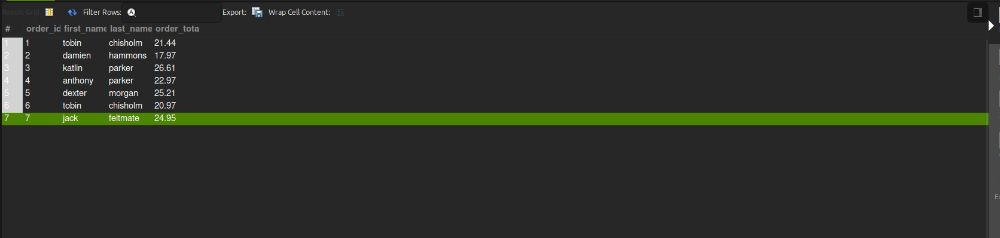

# Assignment 2 — POS Database (pos_tobin)

Builds the point-of-sale database from my Assignment 1 ERD in MySQL, fills it with sample data, and runs the CRUD queries.

## Files

| File | What it does |
|---|---|
| `schema.sql` | Drops and recreates the `pos_tobin` database and its 4 tables (customers, orders, products, orderitems) |
| `seed.sql` | Adds sample data: 6 customers, 8 products, 6 orders, 12 order items |
| `crud.sql` | The 5 CRUD queries: INSERT, SELECT, UPDATE, DELETE, and a multi-table SELECT |
| `screenshot.png` | Result of the multi-table SELECT |

## Change from the Assignment 1 ERD

I added two columns to the Product table: `category` and `stock_quantity`. The SELECT task (stock < 10) and the UPDATE task (raise prices in one category) need them. Everything else matches the ERD: same 4 tables, same primary keys, and the same foreign keys.

## How to load it

The files **must be run in this order**: schema → seed → crud. Each one depends on the one before it.

### how to run

1. Connect to the MySQL container.
2. **File → Open SQL Script** → open `schema.sql`, then press **Ctrl+Shift+Enter** to run the whole file. or the lighting bolt. 
3. Do the same for `seed.sql`.
4. Do the same for `crud.sql`.

## How to check it worked

After running `crud.sql`, the last result should show **7 orders** with the customer name and order total:

| order_id | first_name | last_name | order_total |
|---|---|---|---|
| 1 | tobin | chisholm | 21.44 |
| 2 | damien | hammons | 17.97 |
| 3 | katlin | parker | 26.61 |
| 4 | anthony | parker | 22.97 |
| 5 | dexter | morgan | 25.21 |
| 6 | tobin | chisholm | 20.97 |
| 7 | jack | feltmate | 24.95 |

Notes:
- Order 7 (Jack) is created by the INSERT query in `crud.sql`.
- Walter (customer 6) is removed by the DELETE query. He had no orders, so the foreign key allows it.
- `crud.sql` turns off Workbench's safe update mode (`SET SQL_SAFE_UPDATES = 0;`), because the UPDATE filters by category, not by an ID.
- The UPDATE gives a "data truncated" warning. This is expected: the price is rounded to 2 decimal places to fit `DECIMAL(8,2)`.
- To start over, run all three files again from `schema.sql`. It drops and rebuilds the database.

## Screenshot

